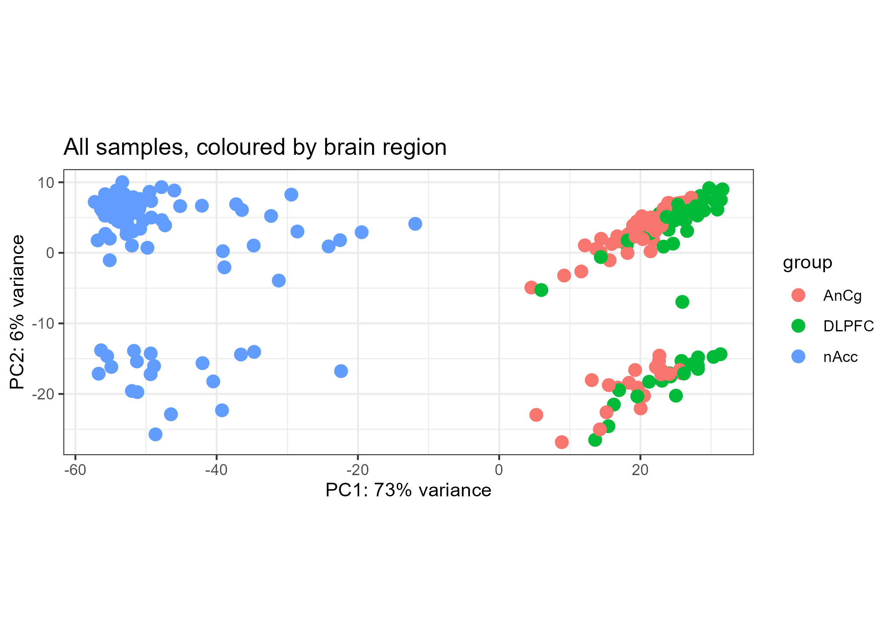
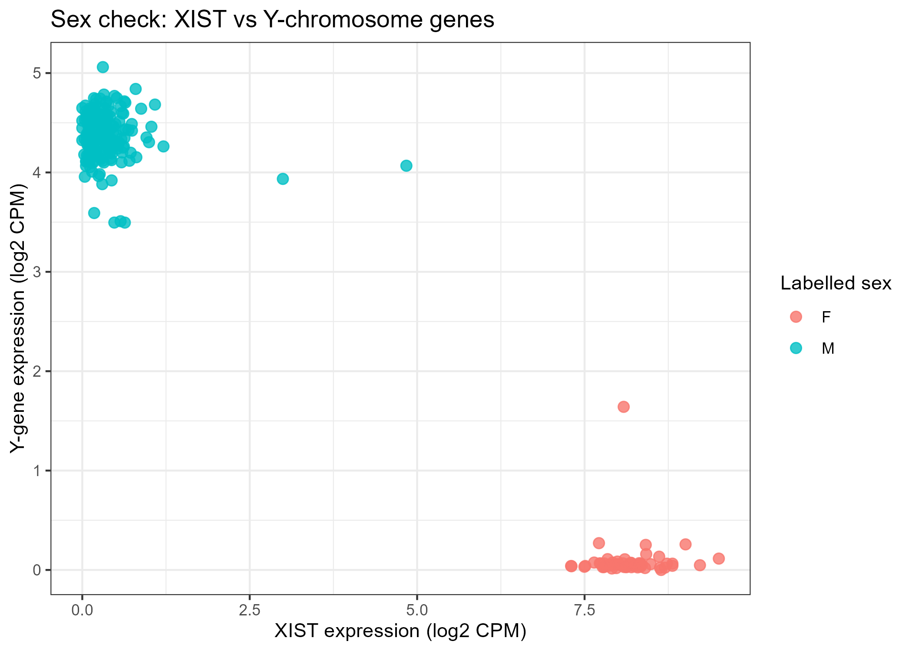
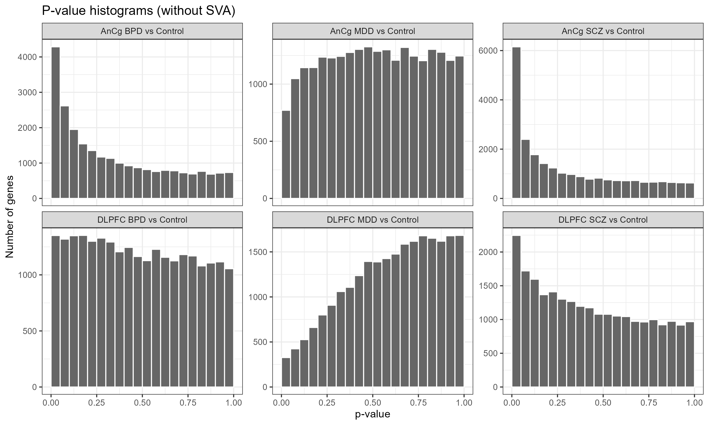
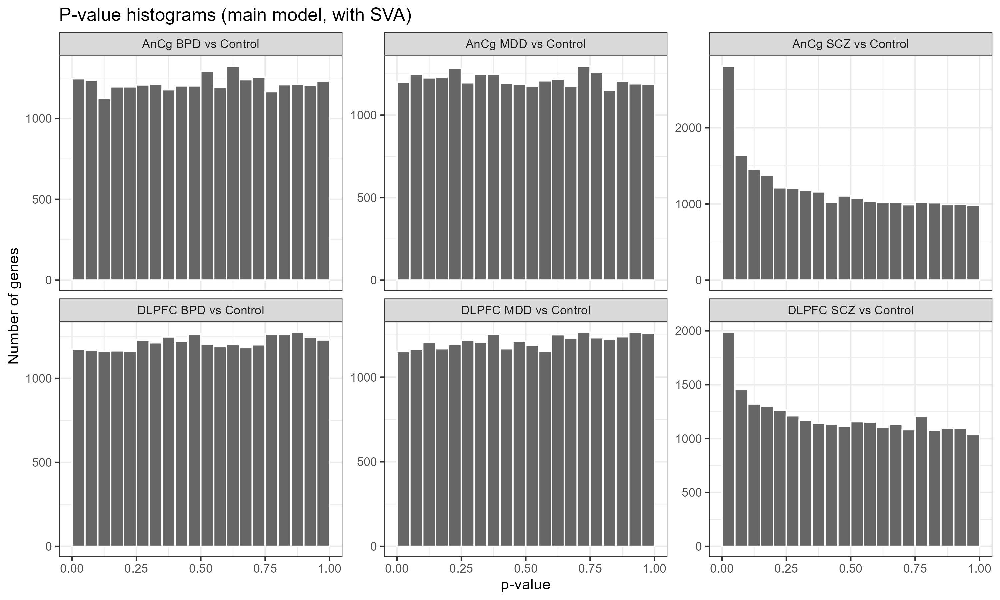
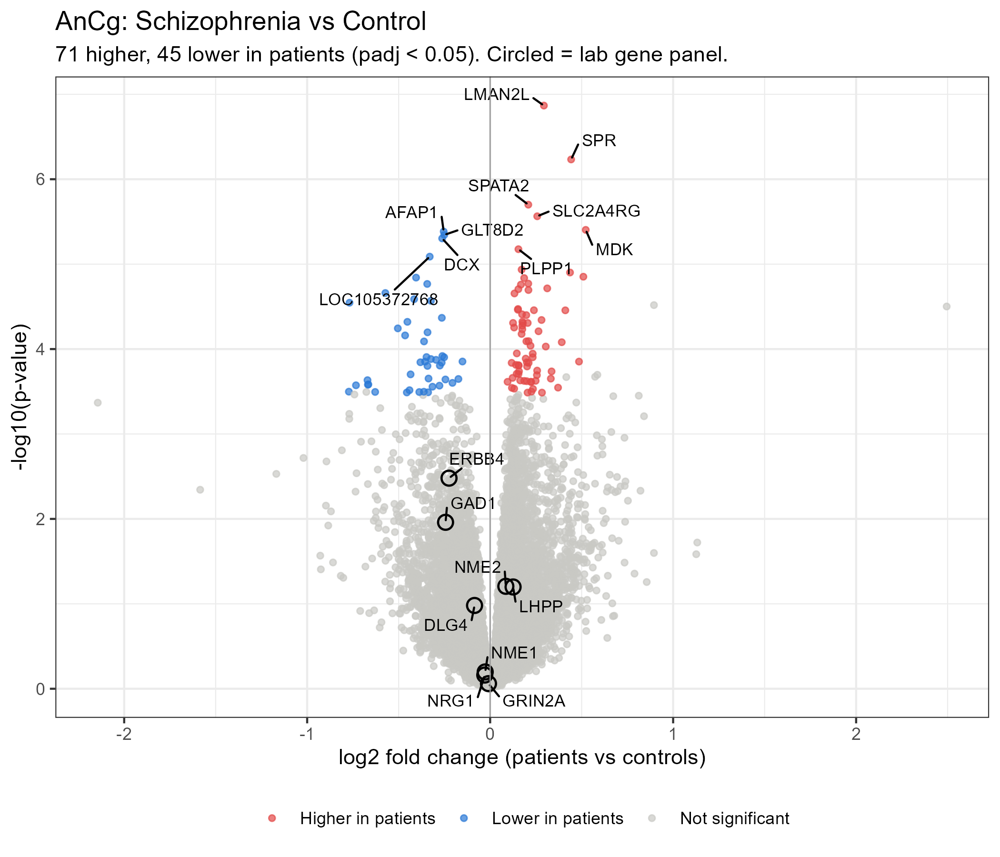
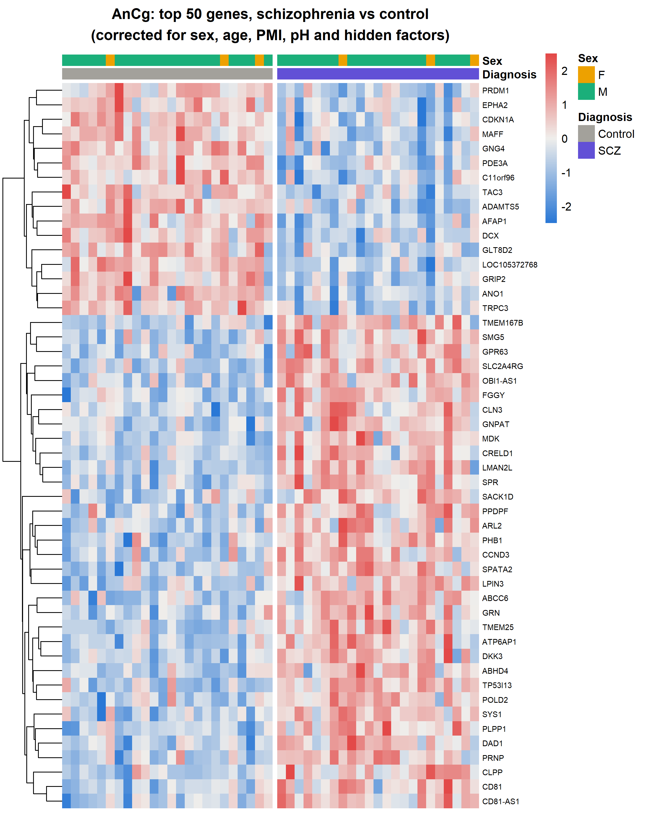
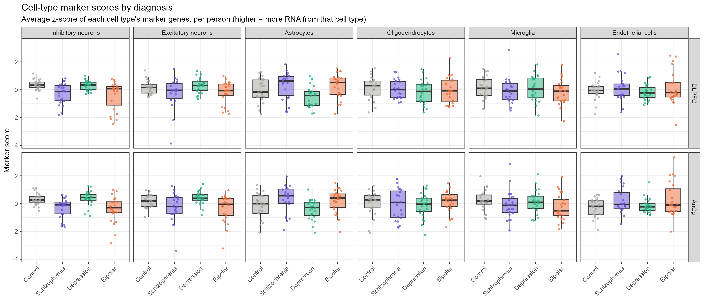
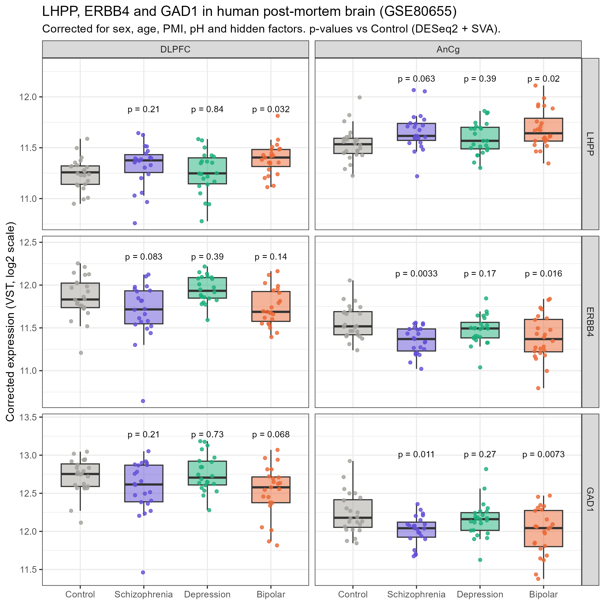
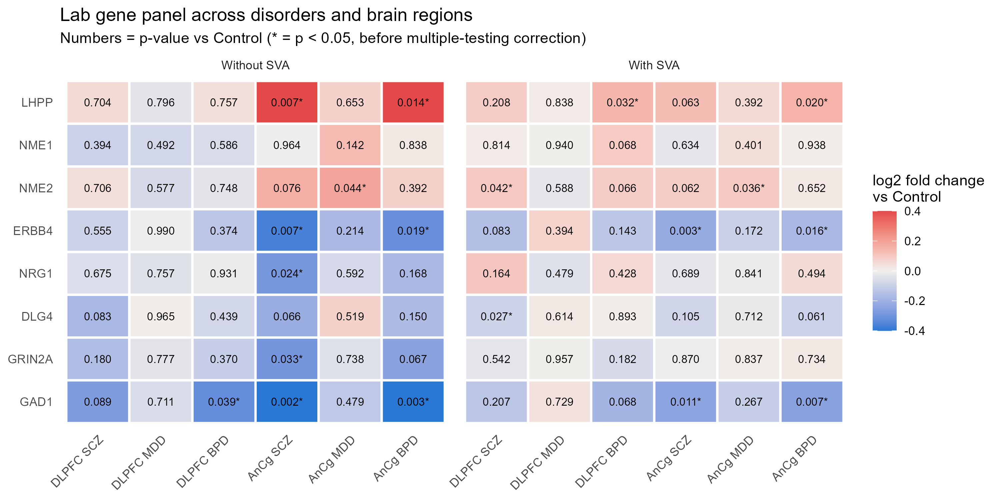
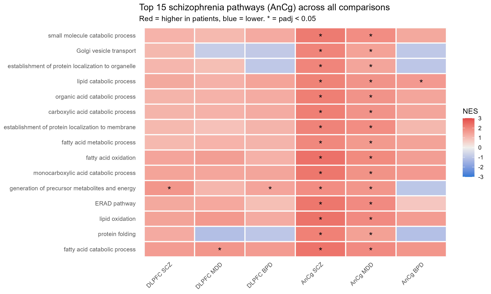

# Gene expression in schizophrenia, bipolar disorder and depression: human post-mortem brain RNA-seq

Differential expression, cell-type and pathway analysis of public RNA-seq data from human post-mortem brain (GEO **GSE80655**). The analysis compares patients with schizophrenia (SCZ), bipolar disorder (BPD) and major depressive disorder (MDD) with healthy controls in two cortical regions, and tests candidate genes studied in mouse models: **ERBB4**, linked to schizophrenia, and **LHPP**, linked to depression.

The project grew out of a wet-lab internship at Shanghai Jiao Tong University in Prof. Weidong Li's lab, where I ran PCR for PhD projects on ERBB4 and LHPP in mouse models. The lab's related published work includes ErbB4 mutant mice (Khan et al., 2025) and multi-omics of the medial prefrontal cortex in a stress model (Wang et al., 2025). Here I ask whether these genes and their pathways change in the brains of human patients. This is an independent analysis of public data, not part of the lab's published work.

**Tools:** R 4.6.1 · Bioconductor 3.23 · DESeq2 1.52 · apeglm · sva · limma (camera) · clusterProfiler 4.20 · org.Hs.eg.db · ggplot2 · pheatmap

---

## Data

| | |
|---|---|
| Dataset | [GSE80655](https://www.ncbi.nlm.nih.gov/geo/query/acc.cgi?acc=GSE80655), Ramaker et al., *Genome Medicine* 2017 |
| Tissue | Post-mortem brain: dorsolateral prefrontal cortex (DLPFC), anterior cingulate cortex (AnCg), nucleus accumbens |
| Counts | NCBI-generated raw counts (GRCh38.p13, NCBI gene IDs) |
| Regions analysed | DLPFC (the classic human prefrontal region) and AnCg (the closest human match to rodent medial PFC) |
| Final samples | DLPFC: 91 (24 Control, 22 SCZ, 22 MDD, 23 BPD) · AnCg: 95 (24 Control, 23 SCZ, 24 MDD, 24 BPD) |
| Donors | Every donor with a DLPFC sample also has an AnCg sample, so the two regions are not independent replicates |

## Pipeline

| Script | What it does |
|---|---|
| `00_install_packages.R` | Installs all packages and records versions in `sessionInfo.txt` |
| `01_download_data.R` | Downloads sample metadata (GEOquery) and the raw count matrix from GEO; maps gene IDs to symbols with org.Hs.eg.db |
| `02_qc_setup.R` | Cleans the sample sheet, removes 3 samples with missing covariates, filters barely detected genes (about 24,300 kept per region), runs PCA quality control |
| `03_deseq2.R` | Genetic sex check (XIST vs Y-chromosome genes, 3 samples removed); DESeq2 with `~ sex + age + PMI + pH + diagnosis`; apeglm fold-change shrinkage |
| `03b_sanity_checks.R` | Covariate balance, surrogate variable analysis (svaseq), p-value histograms with and without SVA |
| `04_plots.R` | Volcano plots and heatmap (SVA model) |
| `05_lab_genes.R` | Candidate gene panel: LHPP, NME1, NME2, ERBB4, NRG1, DLG4, GRIN2A, GAD1 |
| `06_pathways.R` | Gene set enrichment analysis (GSEA) on GO Biological Process and Cellular Component terms, using genes ranked by the DESeq2 Wald statistic |
| `07_cell_types.R` | Cell-type marker scores, their differences by diagnosis, and candidate genes re-tested with adjustment for interneuron content |
| `08_robustness.R` | Key pathways re-tested with limma's camera; direct schizophrenia vs depression comparison |
| `09_sva_vs_cell_types.R` | How much the surrogate variables overlap with cell-type scores; share of small p-values with and without SVA |

## Quality control

Brain region is the largest source of variation: nucleus accumbens separates from the two cortical regions, which works as a positive control. Within each region, the second principal component tracks sex, so sex is included in the model.

**Sex check.** XIST (expressed only in women) was compared with five Y-chromosome genes, using a separate cut-off for each (men: XIST > 2; women: Y-gene signal > 1, log2 CPM; all other samples were far from these cut-offs). Three samples failed: two DLPFC samples from consecutive sequencing libraries (SL7805 and SL7806), which suggests cross-contamination during library preparation, and one nucleus accumbens sample (region not analysed). All three were removed.

  
  

**Hidden variation.** Brain pH differs between diagnosis groups (lower in SCZ and BPD, p < 0.0001), and the original authors adjusted for the percentage of uniquely aligned reads, a sequencing-quality measure that is not in the GEO data. I therefore used surrogate variable analysis (SVA; 11 factors in DLPFC, 13 in AnCg) to capture unmeasured variation. Without SVA the p-values were poorly calibrated: depression had too few small p-values (1.3% of genes at p < 0.05 in DLPFC and 3.2% in AnCg, against 5% expected by chance), a sign of a mis-specified model, while AnCg bipolar disorder had a large excess (17.6%). With SVA, depression and bipolar disorder are close to 5% in both regions (4.7–5.1%), and schizophrenia keeps an excess (DLPFC 8.2%, AnCg 11.5%). Section 2 shows that much of what SVA removes is cell-type composition.

  
  

## Results

### 1. Differentially expressed genes (padj < 0.05)

| Comparison | DLPFC | DLPFC + SVA | AnCg | AnCg + SVA | Original paper |
|---|---|---|---|---|---|
| Schizophrenia vs Control | 4 | 6 | 953 | **116** | 9 (DLPFC), 87 (AnCg) |
| Depression vs Control | 0 | 1 | 0 | 0 | 0 |
| Bipolar vs Control | 0 | 0 | 2 | 0 | 0 |

The SVA model is the main analysis. It gives 116 AnCg schizophrenia genes, close to the 87 in the original study (953 without SVA). Because the surrogate variables also capture cell-type composition (section 2), the main model asks which genes change *beyond* differences in cell composition. Depression produced almost no significant genes in either region, matching the original study.

*Fold changes:* the full gene tables (`results/DE_*.csv`) report apeglm-shrunken log2 fold changes; the volcano plots, candidate-gene summary and box plots use unshrunken estimates.

  
  

The heatmap shows the top 50 genes selected from these same samples, so patients and controls will always look separated; it is an illustration, not extra evidence.

### 2. Cell-type composition

Bulk tissue mixes many cell types, so a gene can look "lower" because the cells that express it are fewer or produce less RNA. Each sample was scored for six cell types using established marker genes (average z-score; ERBB4 and GAD1 were left out of the interneuron score).

Difference from controls in standard-deviation units (DLPFC / AnCg), adjusted for sex, age, PMI and pH (the box plots above show unadjusted scores, so they can differ slightly):

| Cell type | Schizophrenia | Bipolar | Depression |
|---|---|---|---|
| Inhibitory neurons | −0.57 (p = 0.006) / −0.63 (p = 0.002) | −0.56 (p = 0.005) / −0.61 (p = 0.002) | −0.18 (p = 0.37) / −0.11 (p = 0.57) |
| Excitatory neurons | −0.42 (p = 0.047) / −0.50 (p = 0.025) | −0.20 (p = 0.34) / −0.42 (p = 0.058) | −0.11 (p = 0.61) / +0.03 (p = 0.89) |
| Astrocytes | +0.25 (p = 0.25) / +0.42 (p = 0.065) | +0.17 (p = 0.43) / +0.22 (p = 0.32) | −0.04 (p = 0.85) / +0.14 (p = 0.55) |
| Oligodendrocytes, microglia, endothelial cells | no clear differences (all p > 0.1) | | |

The clearest result is lower interneuron-marker RNA in schizophrenia and bipolar disorder, in both regions, but not in depression (FDR 0.04–0.05 across the 36 tests in this table). This matches the original study, which reported lower neuron-specific and higher astrocyte-specific expression in schizophrenia and bipolar disorder. The excitatory-neuron and astrocyte differences are weaker (FDR ≥ 0.18) and only suggestive.

**SVA already captures cell composition.** Together, the surrogate variables explain 80% (DLPFC) and 84% (AnCg) of the variation in the interneuron score, and 72–95% for the other cell types. In both regions the first surrogate variable closely tracks the interneuron score (r = −0.78 in DLPFC, −0.82 in AnCg) and differs between diagnosis groups (p = 0.04 and p = 0.001). So SVA removes part of the disease signal, the lower interneuron RNA, along with technical noise. This probably accounts for much of the drop from 953 to 116 genes in AnCg schizophrenia, and for bipolar disorder losing its signal with SVA (17.6% → 5.1% of genes at p < 0.05), since it has the same interneuron drop as schizophrenia. It also explains why adding the interneuron score on top of SVA changes the number of significant AnCg schizophrenia genes very little (116 before, 110 after; the 6 DLPFC genes drop to 0).

### 3. Candidate genes from the mouse work

- **ERBB4 is lower in schizophrenia and bipolar disorder in AnCg** (SVA model): log2 fold change −0.23 in SCZ (about 14% lower; 10% by the more conservative shrunken estimate), p = 0.003, and −0.18 in BPD (p = 0.016). With two hypotheses defined in advance (ERBB4 in SCZ, LHPP in MDD) tested in two regions, the Bonferroni threshold is 0.0125, which the AnCg SCZ result passes; it does not pass genome-wide correction (padj = 0.13). DLPFC points the same way (p = 0.08), but the donors are the same, so this is not independent replication.
- **ERBB4 does not change independently of other interneuron genes.** After also adjusting for the interneuron score, the difference disappears (AnCg SCZ: log2 fold change −0.04, p = 0.45; BPD: p = 0.56). Lower ERBB4 therefore moves together with a broader loss of interneuron-marker RNA: either fewer interneurons or less RNA per interneuron, which bulk data cannot tell apart. This adjustment is conservative, because lower somatostatin and parvalbumin mRNA are themselves classic post-mortem findings in schizophrenia, including in the anterior cingulate (Hashimoto et al., 2008), so adjusting for interneuron markers can also remove real disease biology. Earlier post-mortem studies of ERBB4 mainly report shifts between splice isoforms in schizophrenia DLPFC (higher JM-a and CYT-1; Law et al., 2007; Chung et al., 2016), which gene-level counts cannot detect.
- **GAD1 (GAD67)** is lower in AnCg SCZ (p = 0.011) and BPD (p = 0.007), in line with one of the most replicated post-mortem findings, but the size of the change is uncertain: the unshrunken estimate is about 16% lower and the shrunken estimate only 2%. In AnCg it also disappears after interneuron adjustment. In DLPFC schizophrenia it flips from lower (p = 0.21) to higher (log2 fold change +0.11, p = 0.016), which is biologically implausible and shows the limit of adjusting for a score that GAD1 tracks closely.
- **LHPP is not changed in depression** in either region (p = 0.39 AnCg, p = 0.84 DLPFC). It is slightly higher in bipolar disorder (AnCg p = 0.020, DLPFC p = 0.032) and in AnCg schizophrenia (p = 0.063). LHPP is primarily expressed in astrocytes (Sha et al., 2023), and astrocyte markers trend upward, so this may reflect astrocyte content; that was not tested directly. The LHPP p-values become smaller after interneuron adjustment, but given the GAD1 artefact above, this is not treated as evidence.
- **Robustness:** NRG1 and GRIN2A were nominally lower in SCZ without SVA but not after it. ERBB4 and GAD1 held up after SVA but not after the additional interneuron adjustment.

### 4. Pathways

GSEA (clusterProfiler) tests GO terms by shuffling genes, which ignores the fact that genes in large programmes move together and can give over-optimistic p-values. Key pathways were therefore re-tested with limma's camera, which accounts for this inter-gene correlation. The camera FDR is calculated across only these 10 pathways, which were chosen after seeing the GSEA results, so passing camera is a robustness check, not a confirmation.

| Region, comparison | Pathway | GSEA NES (padj) | camera FDR | Verdict |
|---|---|---|---|---|
| AnCg, SCZ | Lysosomal membrane ↑ | 2.15 (9e-15) | 0.031 | Survives camera |
| AnCg, SCZ | Lysosomal lumen acidification ↑ | 1.96 (0.008) | 0.031 | Survives camera |
| AnCg, SCZ | Fatty acid oxidation ↑ | 2.37 (1e-7) | 0.020 | Survives camera |
| AnCg, SCZ | Extracellular matrix organization ↓ | −1.92 (8e-6) | 0.050 | Borderline |
| AnCg, MDD | Lysosomal lumen acidification ↑ | 2.23 (0.001) | 0.058 | Suggestive |
| AnCg, MDD | Vacuolar acidification ↑ | 2.34 (2e-4) | 0.058 | Suggestive |
| DLPFC, SCZ | Oxidative phosphorylation ↑ | 2.72 (4e-12) | 0.40 | Does not survive |
| DLPFC, MDD | Nuclear division ↓ | −2.05 (9e-10) | 0.44 | Does not survive |
| DLPFC, BPD | Cytosolic ribosome ↑ | 3.17 (4e-22) | 0.46 | Does not survive |
| AnCg, BPD | GABA-ergic synapse ↓ | −1.62 (0.04) | 0.96 | Does not survive |

- **Lysosome and fatty-acid breakdown up** in AnCg schizophrenia survive camera, and **extracellular matrix down** is borderline (camera FDR 0.050). Lysosomal and lipid-breakdown genes are partly glial, so these pathways may also reflect the glial shift in section 2.
- **In depression, lysosomal acidification is borderline** (camera FDR 0.058) even though no single gene changed. Sha et al. (2023) reported that LHPP helps acidify lysosomes in astrocytes through the V-ATPase, so this is a hypothesis for follow-up, not a demonstrated link.
- **The mitochondrial increase in DLPFC schizophrenia does not survive camera.** These genes also track brain pH and conditions around death, which differ between groups here.
- **The GABA-ergic synapse result** was found by searching after the results were known and does not survive camera, so it is exploratory.
- **Shared controls.** Every disorder is compared with the same 24 controls per region. Many top AnCg schizophrenia pathways are also changed in depression (figure below), and a direct schizophrenia vs depression comparison finds no pathway difference (camera FDR ≥ 0.5) and few gene differences (2 genes in AnCg, none in DLPFC). A shared signal could therefore be shared biology or a feature of the control group; this design cannot tell them apart.
- **GO term names are not tissue labels.** Terms such as "nephron development" or "sarcomere" can appear in brain data because they share genes (for example extracellular matrix, blood-vessel and ribosomal genes) with brain processes, so their names should not be read literally.

## Limitations

- Post-mortem tissue: results reflect the end of the illness and conditions around death, not its cause.
- Bulk tissue: cell-type differences explain part of the gene changes, and SVA removes much of this composition signal along with technical noise (section 2). Marker scores are a rough proxy and cannot separate fewer cells from less RNA per cell.
- Gene-level counts cannot detect ERBB4 splice isoforms.
- The same donors contributed both regions, and all disorders share one control group per region.
- No data on medication or smoking, which can both alter brain gene expression.
- About 24 people per group, so small effects in depression may be missed.
- The pathways re-tested with camera were chosen after seeing the GSEA results.
- Single dataset: findings need replication in an independent cohort.

## Possible next steps

- A model without SVA that uses named cell-type scores as covariates, which is easier to interpret than hidden factors.
- One model across both regions with donor as a random effect (for example `dream` from variancePartition).
- Cell-type deconvolution with a single-nucleus reference, including an astrocyte adjustment for LHPP.
- Transcript-level quantification to test ERBB4 isoforms.
- Replication in an independent cohort such as CommonMind or PsychENCODE.

## How to reproduce

1. Install R (≥ 4.4) and RStudio.
2. Clone the repository (`git clone https://github.com/ayesha-nasir313/brain-rnaseq-deseq2.git`) or use **Code → Download ZIP**, then open `brain-rnaseq-deseq2.Rproj`.
3. Open the scripts in scripts/ folder and run them in order: `00` → `01` → `02` → `03` → `03b` → `04` → `05` → `06` → `07` → `08` → `09`. Raw data download automatically from GEO into `data/` (not included in the repository); result tables go into `results/` and figures into `figures/`. A full run takes about 1.5–2 hours.
4. Package versions are listed in `sessionInfo.txt`.

## License

Code: MIT (see `LICENSE`). Data: public GEO dataset GSE80655 (Ramaker et al., 2017).

## References

- Ramaker RC, et al. Post-mortem molecular profiling of three psychiatric disorders. *Genome Medicine* (2017). doi:10.1186/s13073-017-0458-5
- Love MI, Huber W, Anders S. Moderated estimation of fold change and dispersion for RNA-seq data with DESeq2. *Genome Biology* (2014). doi:10.1186/s13059-014-0550-8
- Zhu A, Ibrahim JG, Love MI. Heavy-tailed prior distributions for sequence count data. *Bioinformatics* (2019). doi:10.1093/bioinformatics/bty895
- Leek JT. svaseq: removing batch effects and other unwanted noise from sequencing data. *Nucleic Acids Research* (2014). doi:10.1093/nar/gku864
- Wu D, Smyth GK. Camera: a competitive gene set test accounting for inter-gene correlation. *Nucleic Acids Research* (2012). doi:10.1093/nar/gks461
- Wu T, et al. clusterProfiler 4.0: a universal enrichment tool for interpreting omics data. *The Innovation* (2021). doi:10.1016/j.xinn.2021.100141
- Gandal MJ, et al. Shared molecular neuropathology across major psychiatric disorders parallels polygenic overlap. *Science* (2018). doi:10.1126/science.aad6469
- Hashimoto T, et al. Conserved regional patterns of GABA-related transcript expression in the neocortex of subjects with schizophrenia. *American Journal of Psychiatry* (2008). doi:10.1176/appi.ajp.2007.07081223
- Law AJ, et al. Disease-associated intronic variants in the ErbB4 gene are related to altered ErbB4 splice-variant expression in the brain in schizophrenia. *Human Molecular Genetics* (2007). doi:10.1093/hmg/ddl449
- Chung DW, et al. Dysregulated ErbB4 splicing in schizophrenia: selective effects on parvalbumin expression. *American Journal of Psychiatry* (2016). doi:10.1176/appi.ajp.2015.15020150
- Khan AA, et al. Exploration of schizophrenia-related behavioral and molecular abnormalities in a mutant mouse model with a mutation in the TVV motif of the ErbB4 gene. *Molecular Brain* (2025). doi:10.1186/s13041-025-01238-2
- Wang Z, et al. Integrated multi-omics analysis reveals immune and metabolic dysregulation in a restraint stress-induced depression model. *Biomedicines* (2025). doi:10.3390/biomedicines13092183
- Lin D, et al. LHPP, a risk factor for major depressive disorder, regulates stress-induced depression-like behaviors through its histidine phosphatase activity. *Molecular Psychiatry* (2023). doi:10.1038/s41380-022-01893-0
- Sha L, et al. LHPP-mediated inorganic pyrophosphate hydrolysis-driven lysosomal acidification in astrocytes regulates adult neurogenesis. *Cell Reports* (2023). PMID: 37573508

---

*Author: Ayesha Nasir · ayeshanasir313@gmail.com*
